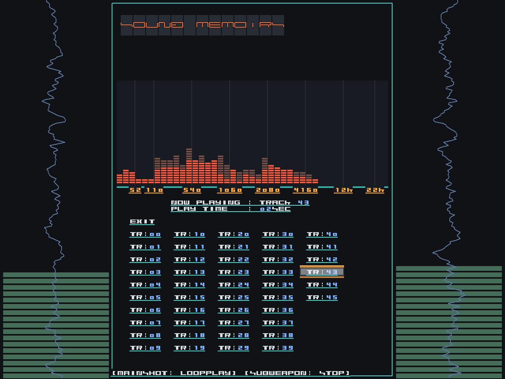
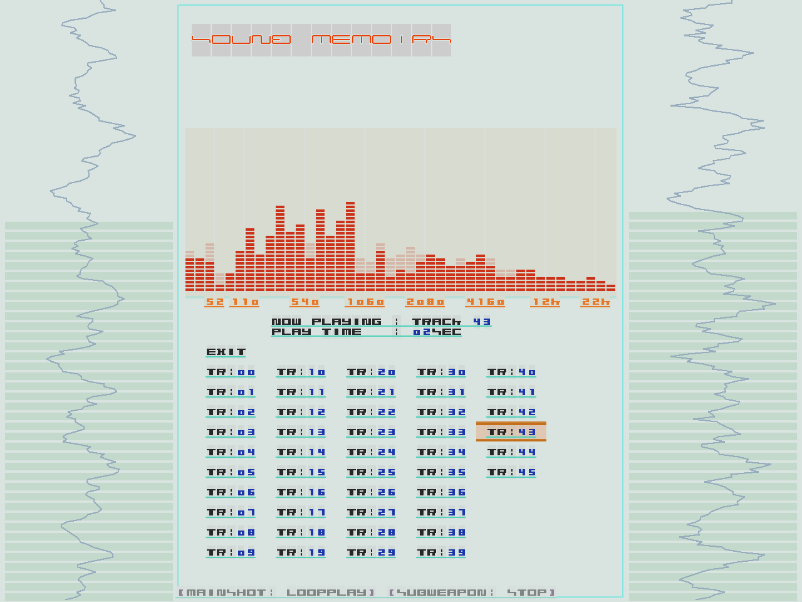
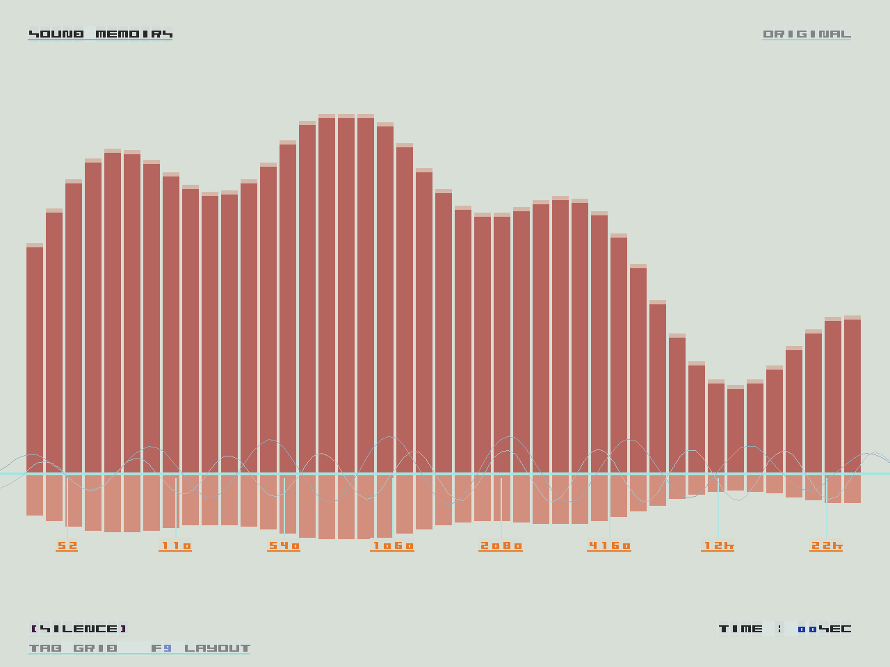
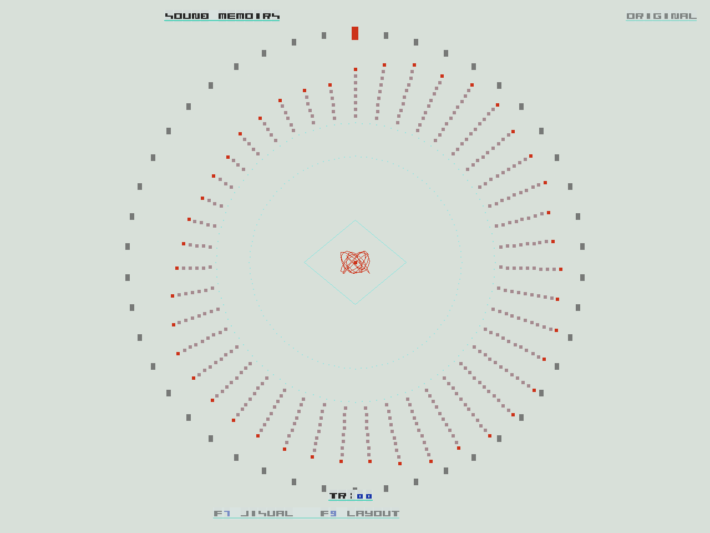
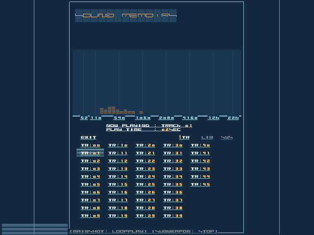

# Hellsinker Style BGM Player

> 复刻 HellSinker 音乐室 **SOUND MEMOIRS** 界面与动效的独立 Windows 点唱机。
> 单文件 exe，无运行库依赖；也能直接当本地音乐播放器用。



---

## 这是什么

原版 HellSinker 的 SOUND MEMOIRS 是一间 5×10 的曲目格子：43 段实时频谱、左右电平条与波形、
一秒一跳的 `PLAY TIME`、选中格上那条脉动的白条。这个项目把那块画面重建成一个**独立小播放器**，
并且除了游戏自带的曲目，还能播放你自己硬盘里的歌。

- **逻辑分辨率 640×480**，窗口可自由缩放 / 最大化，画面等比放大并保持锐利（像素字与矢量混合渲染）
- **五套配色主题**：ORIGINAL / DARK / NEON / PAPER / BLUEPRINT，按 `C` 循环切换
- **双曲源**：`TR` 读取游戏 `backboneteller\bbt*.pak` 里的曲目；`LIB` 管理本地音乐
- **三个紧凑像素频道**：`TR` 原版点唱机、`LIB` 本地曲库、`SYS` 系统设置；`F1` / `F2` / `F3` 直达，右键菜单也可切页、传输、主题和音量
- **频道栏空闲淡出**：无操作约 2.5 秒后 `TR` / `LIB` / `SYS` 平滑淡出，鼠标或键盘活动时立即恢复
- **两种循环语义**：`TR` 游戏曲目播放完始终从头循环；`LIB` 本地曲库单独提供顺序、单曲、列表循环、随机
- **可恢复的本地曲库**：曲目、当前选择和顺序模式关闭时自动保存在 exe 同目录
- **实时可视化**：43 段频谱柱（峰值保持 + 回落尾迹）、左右电平条、上下波形
- **像素级复刻的参数**：文字格位置、颜色、`52…22K` 频率刻度、EXIT 条、提示行半透闪烁
- **无外部依赖**：静态链接，内嵌界面资源，拷走一个 exe 就能跑

英文界面文字使用复刻原版的字格图集，中文和日文由独立的 CJK 绘制路径显示；
标题使用矢量 run 绘制，频率轴的青色轴线为矢量，刻度文字来自英文字格图集。

### 五套主题

| ORIGINAL | NEON |
|---|---|
|  |  |

`C` / `T` 在 ORIGINAL → DARK → NEON → PAPER → BLUEPRINT 之间循环，配色同时作用于背景、频谱柱、电平、
外框、选中高亮、标题与文字。

### 十五种画面布局

`F9` 在十五种构图之间循环，与配色、演出（`F7`）、侧翼（`F8`）相互独立：

| 布局 | 构图 |
|---|---|
| `ORIGINAL` | 复刻的原版面板：顶部标题、中央频谱窗、TR 网格、左右侧翼。输出与改装前逐像素一致 |
| `FIELD` | 全幅示波场：宽幅频谱轮廓与峰值线，下方分列左右声道波形，`TAB` 呼出原版网格 |
| `STACK` | 纵向三栏：左声道电平、中间频谱与波形、右侧完整 46 首列表 |
| `RING` | 环形仪表：43 频段沿圆周放射，曲目成为外圈刻度，中心为 L/R 的 XY 图形 |
| `CROSS` | 十字准星：四轴分区，中心菱形窗显示 XY 图形，`TAB` 呼出原版网格 |
| `SINK` | 下潜井与深度仪表；每个声道各有一组双螺旋，沿两条平行竖轴各自旋转，并作为一组绕中轴整圈旋转，横键承载对应声道的示波线 |
| `DIVE` | 正八边形光门，连续示波线沿八面随左右声道振幅内外摆动 |
| `SONO` | 每秒写入 15 行的频谱瀑布 |
| `TRACK` | 八组频段的十六进制强度滚动谱 |
| `DECK` | 双卷盘磁带机、七段时间显示与电平表 |
| `POLY` | 3D 线框正二十面体晶核：12 个顶点随对应频段刺出，内部八面体反向旋转，下方极简透视地板 |
| `WARP` | 曲速星海：上半屏 72 颗放射星轨，下半屏 16×24 网格频谱山脉向镜头匀速滚来，近山遮远山 |
| `MOIRE` | 莫尔干涉：3 个匀速公转波源的 1px 硬边同心环，音量改变环距，静音时完全定格 |
| `RASTER` | 光栅铜条：8 条 Amiga/DOS 风格硬边铜条沿正弦轨滚动，按深度排序叠压，无渐变 |
| `TORUS` | 矢量环面：8 环 × 12 节共 96 个 3D 像素节点，按深度排序绘制，随低频与中频呼吸 |

STACK 的列表与 RING 的外圈支持选曲。FIELD / CROSS 可用 Tab 打开网格。F7 中央演出和 F8 侧翼在 ORIGINAL 构图可见。

| 全幅场 `FIELD` | 环形 `RING` |
|---|---|
|  |  |

布局只接管 `TR` 页；`LIB` 与 `SYS` 保持原版功能页面。选择写入 `hsbgm.ini` 的 `Layout`。
外部设计参考、代码依据与验收数据见 **[docs/layout-references.md](docs/layout-references.md)**。

### 浏览器与跨平台开发

[TR / WASM 播放器](wasm/README.md) 是浏览器一比一复刻主线，与桌面端共用同一套 C++ 绘制与算法代码（`src/scene.cpp` + `src/gfx.h` 双后端）；导入自己的 PAK 或 WAV / OGG 即可使用。

[Web 视觉实验](web/README.md) 是**纯 JS 探索支线，无需与桌面主线同步**：它不参与一比一复刻，也不共用绘制代码，仅用于比较仪表与档案主题。模块边界、平台评估与测试入口见[架构说明](docs/architecture.md)。



## 下载

到 [Releases](https://github.com/vihithr/hellsinker-sound-memoirs/releases/latest) 下载 `hsbgm.exe`，双击即可运行。

播放**游戏曲目**需要本机装有正版 HellSinker。程序会自动探测常见安装路径，也可以在
exe 同目录的 `hsbgm.ini` 里改 `GameDir=`，或用 `--gamedir <路径>` 指定。
只想听自己的歌就完全不需要游戏：

```
hsbgm.exe --file "D:\music\song.mp3"
```

## 构建

需要 **Visual Studio 2022（x86 工具链）**。仓库根目录直接：

```bat
build.bat
```

脚本会用 `vswhere` 定位 VS 并进入 `vcvars32`，产物在 `dist\hsbgm.exe`。
界面图集通过 `src/memoirs.rc` 内嵌，所以改完 `assets/` 下的位图要重新构建。

想重新生成主题图集 / 标题 run 表：

```
python tools\make_themed_art.py    :: 生成 assets/themed/cells_<i>.bmp
python tools\make_art_runs.py      :: 生成 src/themed_art_runs.h
```

## 操作

| 键 | 功能 |
|---|---|
| `F1` / `F2` / `F3` | 直达 `TR` / `LIB` / `SYS` |
| `TR`：↑ ↓ ← → | 在 `TR:00`～`TR:45` 网格中移动；首列再向上到 EXIT |
| `TR`：Enter / Space | 播放选中游戏曲；选中项正在播放时再次按下会停止；EXIT 上则关窗 |
| `LIB`：↑ / ↓、PgUp / PgDn、滚轮 | 逐行或按每页 7 行移动选择 |
| `LIB`：Enter | 播放当前选中的本地曲目 |
| `LIB`：Space | 本地曲目正在播放或暂停时切换暂停/继续；没有本地曲目活动时播放选中项 |
| `LIB`：← / → | 本地曲目后退 / 前进 5 秒 |
| `LIB`：`/` 或点击搜索栏 | 输入即时筛选 |
| `LIB`：点击曲目行 / 双击 | 选中 / 播放 |
| `LIB`：点击或拖动进度条 | 跳转到本地曲目的对应位置 |
| `LIB`：点击左下顺序标签 | 依次切换顺序（首次默认）→ 单曲 → 列表循环 → 随机 |
| 右键 | 频道、播放控制、打开文件、缩放、演出、侧翼、布局、主题、音量、退出；`LIB` 另含导入与排序命令 |
| `SYS`：↑ / ↓、← / →、Enter | 选择设置行并调整；Enter 向下一档，`←` 向上一档 |
| `SYS`：点击 `-` / `+` | 调整五行 `SYSTEM / CONFIG` 面板：输出音量、配色、界面语言、LIB 曲名字体、画面布局 |
| `Esc` | `TR`：播放中先停止，否则关窗；`LIB`：返回 `TR`；`SYS`：返回来源页 |
| `Ctrl+L` | 从 `LIB` 返回 `TR`，在其他频道打开 `LIB` |
| `Ctrl+O` 或 `M` | 多选文件加入曲库并播放第一项 |
| `N` / `P`、PgDn / PgUp | 按曲库存储顺序下一首 / 上一首 |
| `C` 或 `T` | 循环切换主题 |
| `F6` | 切换 `FIT` / `INTEGER` 窗口缩放 |
| `F1`–`F9` | 全局功能键；搜索框聚焦时仍可切页、缩放、演出、侧翼和布局 |
| `F7` / `F8` / `F9` | 循环播放演出 / 侧翼效果 / 画面布局 |
| `TAB` | 在 `FIELD` / `CROSS` 布局中呼出或收起原版 TR 网格 |
| `+` / `-` | 输出音量 ±5 |
| 拖入文件 | 多文件加入曲库并播放第一项 |

完整说明见 **[USAGE.md](USAGE.md)**。

## 目录结构

```
build.bat              MSVC 构建脚本
stb_vorbis.c           OGG 解码（第三方）
src/                   播放器源码（Win32 + GDI + Media Foundation）
  layout.cpp/.h        画面布局的几何与名称（原版几何表为基准）
assets/               界面图集与文本资源
tools/                图集 / run 表生成脚本
docs/                 README 用截图
USAGE.md              面向使用者的文档
```

## 声明

- 本项目是**非官方粉丝作品**，与原作的开发者、发行方无任何关系。
- 仓库**不包含任何游戏音频或美术资源本体**。游戏曲目由程序在你本机读取已购买的
  HellSinker 安装目录里的 pak 文件；`assets/` 下的界面字形图集仅用于复刻界面排版。
- 界面字形的来源与授权见 [THIRD_PARTY_NOTICES.md](THIRD_PARTY_NOTICES.md)。

## 许可

本仓库自有代码以 [MIT](LICENSE) 授权。第三方组件与界面文本资源另按其各自许可，
详见 [THIRD_PARTY_NOTICES.md](THIRD_PARTY_NOTICES.md)。
---

## English

A standalone Win32 jukebox that recreates the **SOUND MEMOIRS** screen from *Hellsinker* — the 5×10 track grid, 43-band spectrum, level meters, waveform and the one-second `PLAY TIME` tick — and can also play your own local music library.

- **Download:** grab `hsbgm.exe` from [Releases](https://github.com/vihithr/hellsinker-sound-memoirs/releases/latest) and run it. No runtime required.
- **Game tracks:** install a legitimate copy of Hellsinker. The player auto-detects common install paths; otherwise set `GameDir=` in `hsbgm.ini` or pass `--gamedir <path>`.
- **Local music:** `hsbgm.exe --file "D:\music\song.mp3"`.
- **Build:** Visual Studio 2022 with the x86 toolchain, then run `build.bat` in the repository root.
- **Web/WASM experiment:** https://vihithr.github.io/hellsinker-sound-memoirs/

The interface follows the original 640×480 layout, with five themes (ORIGINAL / DARK / NEON / PAPER / BLUEPRINT), `TR` for game tracks and `LIB` for local files. See [USAGE.md](USAGE.md) for the full key map.
## Web 主线发布

桌面与 WASM 共用绘制代码。每轮涉及播放器的改动完成后，构建两端并验证；执行 `tools/sync_site.ps1`，将 Web 产物同步到仓库根目录和 `dist-static/`。将本轮改动提交并推送到 `main`，GitHub Pages 自动从该分支根目录发布。以线上 `core/core.wasm` 的 SHA-256 与本地一致作为发布验收。
