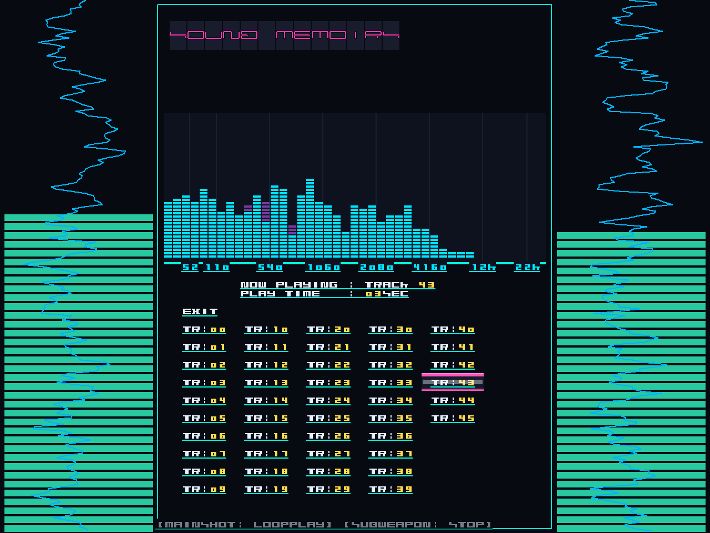

# Hellsinker Style BGM Player

> 复刻 HellSinker 音乐室 **SOUND MEMOIRS** 界面与动效的独立 Windows 点唱机。
> 单文件 exe，无运行库依赖；也能直接当本地音乐播放器用。


---

## 这是什么

原版 HellSinker 的 SOUND MEMOIRS 是一间 5×10 的曲目格子：43 段实时频谱、左右电平条与波形、
一秒一跳的 `PLAY TIME`、选中格上那条脉动的白条。这个项目把那块画面重建成一个**独立小播放器**，
并且除了游戏自带的曲目，还能播放你自己硬盘里的歌。

- **逻辑分辨率 640×480**，窗口可自由缩放 / 最大化，画面等比放大并保持锐利（像素字与矢量混合渲染）
- **四套配色主题**：ORIGINAL / DARK / NEON / PAPER，按 `C` 循环切换
- **双曲源**：直接读取游戏 `backboneteller\bbt*.pak` 里的曲目；或拖入 / 多选本地音频文件
- **实时可视化**：43 段频谱柱（峰值保持 + 回落尾迹）、左右电平条、上下波形，播放时整曲自动循环
- **像素级复刻的参数**：文字格位置、颜色、`52…22K` 频率刻度、EXIT 条、提示行半透闪烁
- **无外部依赖**：静态链接，内嵌界面资源，拷走一个 exe 就能跑

界面字形来自原版风格的像素图集（最近邻放大，不糊），标题与频率轴用矢量矩形绘制，
任意倍率下笔画都不糊、不丢线。

### 四套主题

| ORIGINAL | NEON |
|---|---|
|  |  |

`C` / `T` 在 ORIGINAL → DARK → NEON → PAPER 之间循环，配色同时作用于背景、频谱柱、电平、
外框、选中高亮、标题与文字。

## 下载

到 [Releases](../../releases) 下载 `hsbgm.exe`，双击即可运行。

播放**游戏曲目**需要本机装有正版 HellSinker。程序会自动探测常见安装路径，也可以在
exe 同目录的 `hsbgm.ini` 里改 `GameDir=`，或用 `--gamedir <路径>` 指定。
只想听自己的歌就完全不需要游戏：

```
hsbgm.exe --file "D:\music\song.mp3"
```

## 构建

需要 **Visual Studio 2022（x86 工具链）**。仓库根目录直接：

```bat
build.bat
```

脚本会用 `vswhere` 定位 VS 并进入 `vcvars32`，产物在 `dist\hsbgm.exe`。
界面图集通过 `src/memoirs.rc` 内嵌，所以改完 `assets/` 下的位图要重新构建。

想重新生成主题图集 / 标题 run 表：

```
python tools\make_themed_art.py    :: 生成 assets/themed/cells_<i>.bmp
python tools\make_art_runs.py      :: 生成 src/themed_art_runs.h
```

## 操作

| 键 | 功能 |
|---|---|
| ↑ ↓ ← → | 网格移动（首行再向上到 EXIT） |
| Enter / Space | 播放选中曲；同曲再按 = 停止 |
| S / Esc | 停止（未播放时 Esc 关窗） |
| + / - | 音量 ±5 |
| Ctrl+O 或 M | 多选文件 → 加入播放列表 |
| N / P、PgDn / PgUp | 下一首 / 上一首 |
| C 或 T | 切换主题 |
| 鼠标单击 / 双击 | 选中 / 播放 |
| 拖拽文件 | 多文件入播放列表 |

完整说明见 **[USAGE.md](USAGE.md)**。

## 目录结构

```
build.bat              MSVC 构建脚本
stb_vorbis.c           OGG 解码（第三方）
src/                   播放器源码（Win32 + GDI + Media Foundation）
assets/               界面字格图集与字体
tools/                图集 / run 表生成脚本
docs/                 README 用截图
USAGE.md              面向使用者的文档
```

## 声明

- 本项目是**非官方粉丝作品**，与原作的开发者、发行方无任何关系。
- 仓库**不包含任何游戏音频或美术资源本体**。游戏曲目由程序在你本机读取已购买的
  HellSinker 安装目录里的 pak 文件；`assets/` 下的界面字形图集仅用于复刻界面排版。
- 界面字形的来源与授权见 [THIRD_PARTY_NOTICES.md](THIRD_PARTY_NOTICES.md)。

## 许可

本仓库自有代码以 [MIT](LICENSE) 授权。第三方组件与字体另按其各自许可，
详见 [THIRD_PARTY_NOTICES.md](THIRD_PARTY_NOTICES.md)。
